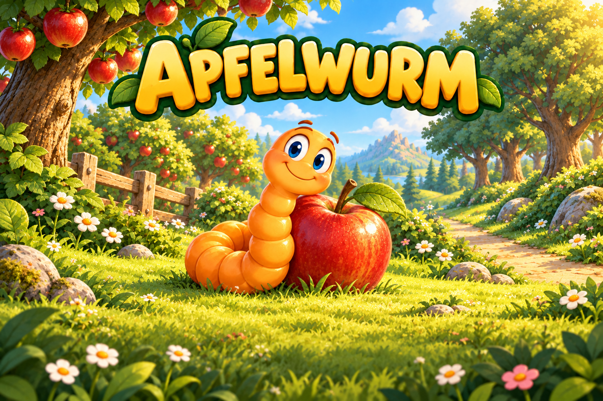
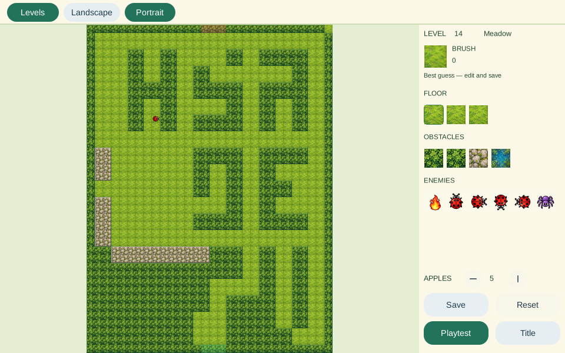

<p align="center">
  
</p>

<p align="center">
  <strong>A little worm. A long journey.</strong><br>
  <a href="https://wurm.waozi.xyz/"><strong>Play free in your browser</strong></a>
  · <a href="https://github.com/waozixyz/wurm/releases/latest"><strong>Download for Android</strong></a>
  · <a href="CHANGELOG.md">What's new</a>
</p>

# Apfelwurm

Collect the apples. Find the gate. Keep growing.

Guide a little orange worm from sunny apple meadows through woodland and
lakeshores to the mountains. Apfelwurm brings the spirit of the original
Worm game to **200 distinct levels**, with illustrated landscapes, a gentle
acoustic soundtrack and controls that respond while your finger stays down.

Free to play. All 200 levels can be unlocked through play. No ads. An optional account keeps your
progress and character choices in sync, with cosmetic skins available for Dew.

The standard Android APK and the `-fdroid.apk` download exclude Google libraries.
Choose the separate `-gplay.apk` for Google Play Billing. The standard and
F-Droid editions use Monero for Dew top-ups.

## Five landscapes. Forty levels each.

- **Meadow:** learn at a gentle pace on spacious orchard paths. The first 20 levels have no moving enemies; matching portal rings introduce a simple shortcut from level 10.
- **Leafwood:** weave through leafy rooms, mossy courtyards and branching trails.
- **Pinewood:** follow fir-lined passages and watch the patrols around the next corner.
- **Lake:** cross the shores, channels and islands without running out of room.
- **Mountains:** wind through rock corridors, terraces and the final ascent.

Layouts take inspiration from the recovered original game's rooms, spirals
and crossings. Wandering fire, bouncing patrols and chasing enemies make the
journey more demanding as you climb.

Meadow's landscape boards follow the portrait gardens' hedges and clear routes.
Portal lessons appear on levels 10, 12, 16, 23, 31 and 38, with open exits and no
moving enemies. Personal editor layouts keep priority over the new defaults.

Press **Play** and you are straight in the game. The levels follow one after
another through all five landscapes. After each goal, preview the next board
and press **Start level** (or Enter/Space) when ready. The worm and enemies wait
while you look around. You start
with three lives and earn more as your score grows. Score and lives carry
between levels throughout your run. **Continue** starts the furthest level
reached in your journey with three lives and a fresh score, even after a game
over or closing the game. **Play from start** begins a new run at level 1
without erasing your progress.

**Choose level** lets you browse all five landscapes, see a large board preview for unlocked levels and a lock for later levels.
Complete a level to unlock the next one.
After a game over, **Try again** starts the furthest unlocked level with
three lives and a fresh score.

## Play your way

On a phone or tablet, choose **swipe steering** or a **direction pad** on first
play. With swipe steering, move your finger in the direction you want to turn
and keep it on the screen for the next corner. Change your choice from Pause at
any time.

On a computer, steer with the arrow keys or WASD; Settings shows those keys.
Space or Escape pauses; M mutes.
Collect every apple, then leave through the opening at the top of the board.

Desktop **Local multiplayer**, in Settings, puts two to four players on one
keyboard; give each player a name and a skin you own. Everyone
enters through a separate bottom lane. Collect the shared apples, grow, and stay
clear of every worm: the last one alive wins. Player 1 uses the arrows, Player 2
WASD, Player 3 IJKL, and Player 4 the numeric keypad's 8/4/5/6. Space or Escape
pauses the round. Local rounds keep their own scores.

Portrait and landscape use their own board layouts. Your unfinished run stays
on this device. Android and the browser can play offline after their assets
are loaded. Signing in syncs earned completion marks and preferences.

## Make a path of your own

Open **Level editor** from the title, or press **E**. Start a **New level**
on an empty board in any landscape you have reached, or copy a level you have
reached with **From a level**. Paint terrain and enemies, adjust the apple
goal, then playtest from the entrance. In Arcade, the editor is also its own
**Apfelwurm Editor** app.

Your levels live in **My levels**, in collections you can name, reorder and
delete. They are private: only you see them, and they follow your account.
**Share** a collection with your friends or everyone, or make it private
again; Shovey uses the same sharing. **Community** shows collections other
players shared, newest first or by player name. **Add to My levels** keeps
a private copy you can rename, play and change.
Campaign levels you changed in older versions still play as you made them;
**Campaign changes** lists them so you can reset each one.

**Landscape** and **Portrait** are independent editor modes. A portrait you
have not made yet shows the mirror of the landscape, so both play alike;
refine it and save without changing the landscape. Playtest always uses the
selected layout.

<p align="center"></p>

## Keep the journey yours

Open **Settings** on the title to choose the softer Dusk, Forest or Sage theme,
change controls or switch sound on and off. **Profile** uses the same account
system as Shovey: create an account, import your key or link another device.
Inside Arcade or Inner Breeze, the host supplies Profile, Dew and navigation;
the game's title keeps Shop and Settings without duplicating those controls.
Completion marks, active playtime, preferences and your chosen skin follow the
signed-in account. Guest progress and each account stay separate. Your
unfinished run and personal editor records stay on this device.

The title's **Shop** shows your coins and Dew beside it. Its **Skins** tab
offers Mint for **10 Dew**, Berry for **20 Dew** and Rose for **30 Dew**, with
confirmation before buying. **Coins** sells 150, 400 or 900 coins for 2, 5 or
10 Dew, and **Dew** tops up your Dew. Retrying a purchase,
including from another device, cannot charge for that skin twice. Earn
**Night owl** by playing actively for **5 hours**, **Golden apple** by
reaching **level 40**, or **Explorer** by opening **waozi.xyz** from the shop.
Levels unlock through play; Dew buys optional cosmetics.

Earn **10 coins** for a level's first clear and **2 coins** when replaying it.
Coins unlock **Moss** for 120, **River** for 240 and **Mushroom** for 360.
The chest on the title glows when a **Daily reward** is ready; tap it to see
the next few days. The 30-day plan gives mostly coins, Mushroom on day 7 and
**Aurora** on day 30. Dew is rare: a connected account collects 2 Dew on day 10
and 3 Dew on day 25, once, after the node has counted that many daily
check-ins. Guests receive coins on those days. Claims reset at midnight UTC; missing a day keeps your
place. Later calendars give coins in place of Dew and skin gifts. Already-owned
gift skins give 100 coins. Winter cheer remains claimable in December 2026.

Account sync and Dew need a connection. There is no advertising or analytics,
and personal editor records are kept out of published packages.

[Play Apfelwurm](https://wurm.waozi.xyz/)
· [Android downloads](https://github.com/waozixyz/wurm/releases/latest)
· [Browser privacy](https://wurm.waozi.xyz/privacy.html)

## Build and contribute

Built with [Ziran](https://ziran-lang.org) and [Kryon](https://kryonlabs.com).
The desktop, Android and browser editions share the same game rules.

```sh
LDLIBS=-lz ziran run --target=c tools/build_desktop.zi
build/account-desktop/wurm
LDLIBS=-lz ziran run --target=c tests/run_local.zi
```

See the [build and development guide](docs/building.md) for the editor's
save files, Android and portable builds, asset recovery and verification.
[Report a bug or suggest a level](https://github.com/waozixyz/wurm/issues).
